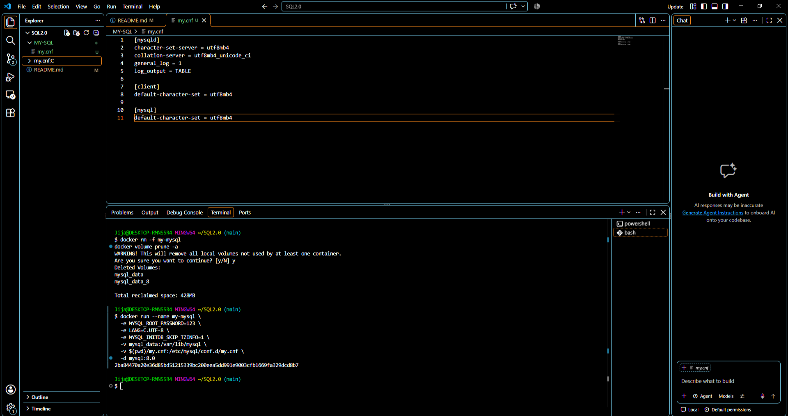
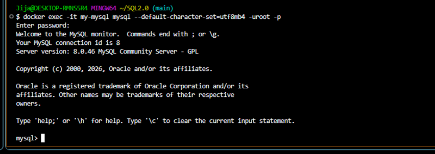
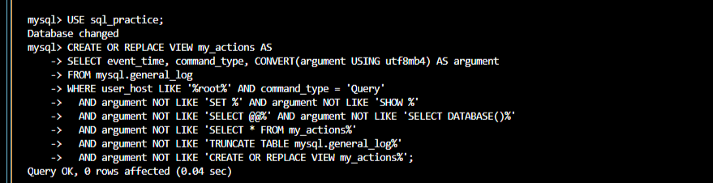
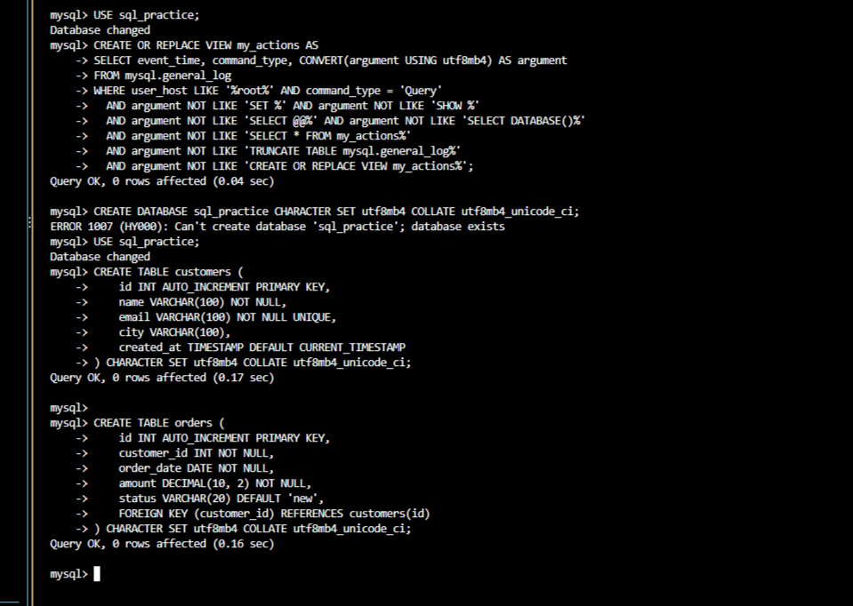
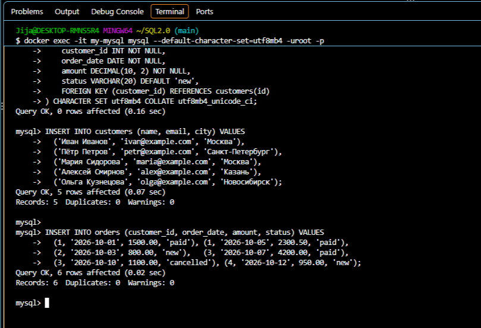
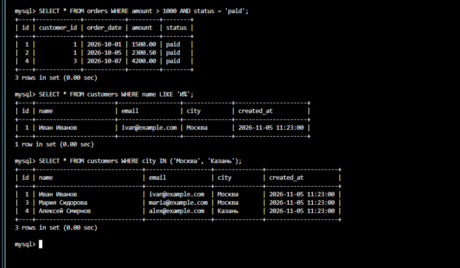
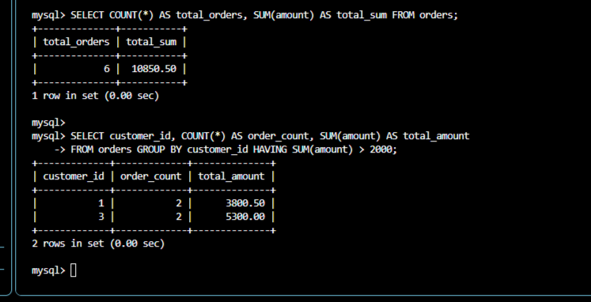
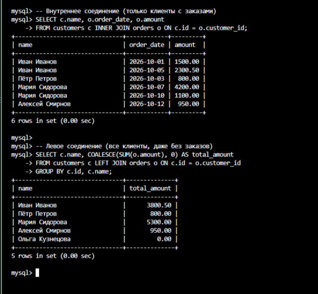
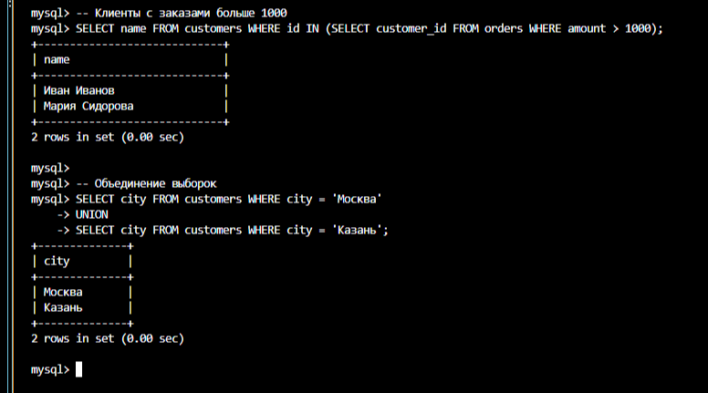
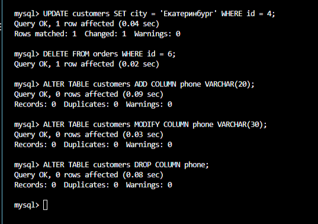

---

### 🟢 Блок 1. Подготовка окружения и запуск Docker
*Выполняется в терминале вашей ОС.*

**1. Создайте или обновите файл конфигурации `my.cnf`**
В рабочей папке (например, `my-mysql`) создайте файл `my.cnf` и вставьте туда этот код:
```ini
[mysqld]
character-set-server = utf8mb4
collation-server = utf8mb4_unicode_ci
general_log = 1
log_output = TABLE

[client]
default-character-set = utf8mb4

[mysql]
default-character-set = utf8mb4
```


**2. Запустите контейнер с MySQL**
Если старый контейнер не нужен, удалите его и volume:
```bash
docker rm -f my-mysql
docker volume prune -a
```
Создайте новый контейнер:
```bash
docker run --name my-mysql \
  -e MYSQL_ROOT_PASSWORD=123 \
  -e LANG=C.UTF-8 \
  -e MYSQL_INITDB_SKIP_TZINFO=1 \
  -v mysql_data:/var/lib/mysql \
  -v $(pwd)/my.cnf:/etc/mysql/conf.d/my.cnf \
  -d mysql:8.0
```
*(Подождите 10-20 секунд, пока MySQL инициализируется).*



**3. Подключитесь к MySQL**
```bash
docker exec -it my-mysql mysql --default-character-set=utf8mb4 -uroot -p
```
Введите пароль: `123`. Теперь вы в консоли `mysql>`.



---

### 🔵 Блок 2. Настройка логирования и создание БД
*Выполняется в консоли `mysql>`.*

**4. Включите запись общего лога в таблицу**
```sql
SET GLOBAL general_log = 'ON';
SET GLOBAL log_output = 'TABLE';
```


**5. Создайте учебную базу данных и переключитесь на неё**
```sql
CREATE DATABASE sql_practice CHARACTER SET utf8mb4 COLLATE utf8mb4_unicode_ci;
USE sql_practice;
```


**6. Создайте VIEW для удобного просмотра ваших действий**
Этот запрос отфильтрует системный мусор из логов:
```sql
CREATE OR REPLACE VIEW my_actions AS
SELECT event_time, command_type, CONVERT(argument USING utf8mb4) AS argument
FROM mysql.general_log
WHERE user_host LIKE '%root%' AND command_type = 'Query'
  AND argument NOT LIKE 'SET %' AND argument NOT LIKE 'SHOW %'
  AND argument NOT LIKE 'SELECT @@%' AND argument NOT LIKE 'SELECT DATABASE()%'
  AND argument NOT LIKE 'SELECT * FROM my_actions%'
  AND argument NOT LIKE 'TRUNCATE TABLE mysql.general_log%'
  AND argument NOT LIKE 'CREATE OR REPLACE VIEW my_actions%';
```



---

### 🟣 Блок 3. Создание таблиц и вставка данных
*Выполняется в консоли `mysql>`.*

**7. Создайте таблицы `customers` и `orders`**
```sql
CREATE TABLE customers (
    id INT AUTO_INCREMENT PRIMARY KEY,
    name VARCHAR(100) NOT NULL,
    email VARCHAR(100) NOT NULL UNIQUE,
    city VARCHAR(100),
    created_at TIMESTAMP DEFAULT CURRENT_TIMESTAMP
) CHARACTER SET utf8mb4 COLLATE utf8mb4_unicode_ci;

CREATE TABLE orders (
    id INT AUTO_INCREMENT PRIMARY KEY,
    customer_id INT NOT NULL,
    order_date DATE NOT NULL,
    amount DECIMAL(10, 2) NOT NULL,
    status VARCHAR(20) DEFAULT 'new',
    FOREIGN KEY (customer_id) REFERENCES customers(id)
) CHARACTER SET utf8mb4 COLLATE utf8mb4_unicode_ci;
```


**8. Вставьте тестовые данные**
```sql
INSERT INTO customers (name, email, city) VALUES
  ('Иван Иванов', 'ivan@example.com', 'Москва'),
  ('Пётр Петров', 'petr@example.com', 'Санкт-Петербург'),
  ('Мария Сидорова', 'maria@example.com', 'Москва'),
  ('Алексей Смирнов', 'alex@example.com', 'Казань'),
  ('Ольга Кузнецова', 'olga@example.com', 'Новосибирск');

INSERT INTO orders (customer_id, order_date, amount, status) VALUES
  (1, '2026-10-01', 1500.00, 'paid'), (1, '2026-10-05', 2300.50, 'paid'),
  (2, '2026-10-03', 800.00, 'new'),   (3, '2026-10-07', 4200.00, 'paid'),
  (3, '2026-10-10', 1100.00, 'cancelled'), (4, '2026-10-12', 950.00, 'new');
```


---

### 🟠 Блок 4. Выборки, JOIN и агрегации
*Выполняется в консоли `mysql>`. Попробуйте выполнить эти запросы, чтобы понять синтаксис.*

**9. Базовые выборки (WHERE, LIKE, IN, BETWEEN)**
```sql
SELECT * FROM customers WHERE city = 'Москва';
SELECT * FROM orders WHERE amount > 1000 AND status = 'paid';
SELECT * FROM customers WHERE name LIKE 'И%';
SELECT * FROM customers WHERE city IN ('Москва', 'Казань');
```


**10. Агрегатные функции и группировка**
```sql
SELECT COUNT(*) AS total_orders, SUM(amount) AS total_sum FROM orders;

SELECT customer_id, COUNT(*) AS order_count, SUM(amount) AS total_amount
FROM orders GROUP BY customer_id HAVING SUM(amount) > 2000;
```


**11. Соединение таблиц (JOIN)**
```sql
-- Внутреннее соединение (только клиенты с заказами)
SELECT c.name, o.order_date, o.amount 
FROM customers c INNER JOIN orders o ON c.id = o.customer_id;

-- Левое соединение (все клиенты, даже без заказов)
SELECT c.name, COALESCE(SUM(o.amount), 0) AS total_amount
FROM customers c LEFT JOIN orders o ON c.id = o.customer_id
GROUP BY c.id, c.name;
```



**12. Подзапросы и UNION**
```sql
-- Клиенты с заказами больше 1000
SELECT name FROM customers WHERE id IN (SELECT customer_id FROM orders WHERE amount > 1000);

-- Объединение выборок
SELECT city FROM customers WHERE city = 'Москва'
UNION
SELECT city FROM customers WHERE city = 'Казань';
```

---


### 🔴 Блок 5. Изменение данных, структуры и создание бэкапа

**13. Обновление и удаление (UPDATE / DELETE)** *В консоли `mysql>`*
```sql
UPDATE customers SET city = 'Екатеринбург' WHERE id = 4;
DELETE FROM orders WHERE id = 6;
```

**14. Изменение структуры таблицы (ALTER)** *В консоли `mysql>`*
```sql
ALTER TABLE customers ADD COLUMN phone VARCHAR(20);
ALTER TABLE customers MODIFY COLUMN phone VARCHAR(30);
ALTER TABLE customers DROP COLUMN phone;
```



**15. Создание дампа (бэкапа)** 
Выйдите из MySQL (`\q`), чтобы вернуться в **терминал хоста**.
Сделайте дамп базы:
```bash
docker exec -e MYSQL_PWD=123 my-mysql mysqldump -uroot \
  --set-gtid-purged=OFF --single-transaction \
  sql_practice > dump_clean.sql
```
*(Также можно экспортировать лог ваших действий: `docker exec -e MYSQL_PWD=123 my-mysql mysql -uroot --default-character-set=utf8mb4 -e "SELECT * FROM sql_practice.my_actions ORDER BY event_time DESC" > my_actions_export.txt`)*

---

### 🟤 Блок 6. Удаление и восстановление БД

**16. Удаление базы** *Зайдите обратно в `mysql>`*
```sql
DROP DATABASE sql_practice;
EXIT;
```

**17. Восстановление из дампа** *В терминале хоста*
Создайте пустую базу (зайдите в `mysql>`, выполните `CREATE DATABASE sql_practice CHARACTER SET utf8mb4 COLLATE utf8mb4_unicode_ci;` и выйдите через `\q`).

Импортируйте дамп:
```bash
docker exec -i my-mysql mysql -uroot -p123 sql_practice < dump_clean.sql
```

**18. Проверка восстановления** *Зайдите в `mysql>`*
```sql
USE sql_practice;
SHOW TABLES;
SELECT * FROM customers;
SELECT * FROM my_actions LIMIT 5; -- Проверка, что VIEW и логи восстановились
```
